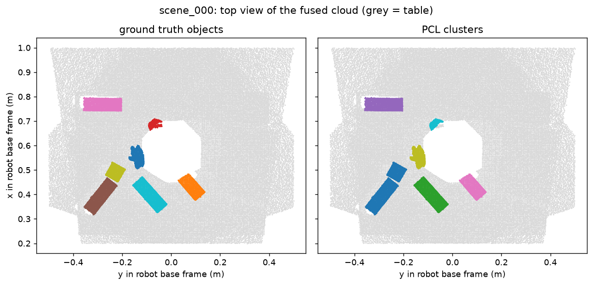
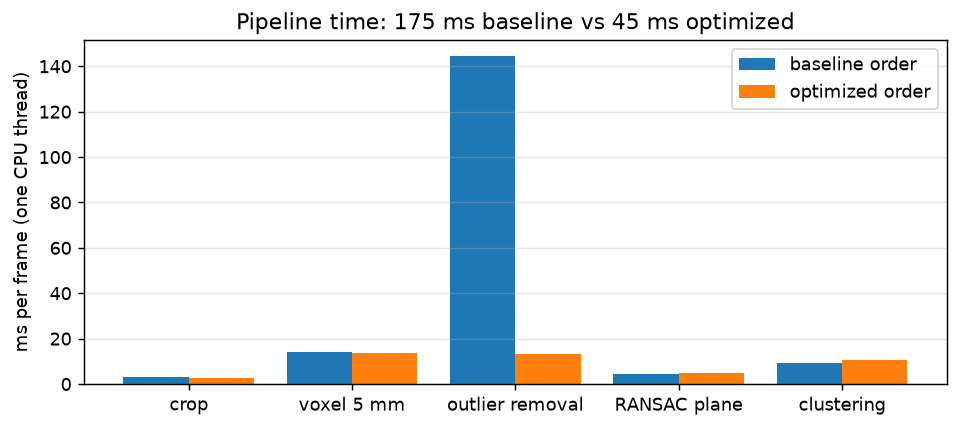
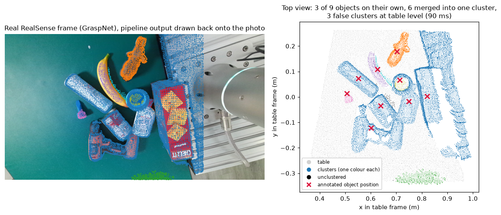

# 3D Workspace Reconstruction and Segmentation for a Cobot Table (C++ / PCL)

A robot arm needs a stable 3D model of its workspace before it can plan a grasp, and a single depth frame is
noisy and full of holes. This project fuses several wrist camera views into one point cloud in the robot
base frame and splits it into separate objects with a classical PCL pipeline in C++.

Scenes come from a simulated workcell (PyBullet: Franka Panda arm with a wrist camera, cluttered table),
which gives a ground truth object label for every point, so the segmentation can be scored exactly. The same
pipeline is also run on a real RealSense frame recorded on a robot arm (see Real data check).



## Pipeline

```
5 wrist camera views ──► back project ──► base frame (forward kinematics x hand eye) ──► fuse
   ──► crop box ──► voxel grid 5 mm ──► RANSAC table plane ──► outlier removal ──► Euclidean clustering ──► objects
```

| Stage | Detail | Code |
| --- | --- | --- |
| Capture and fusion | The simulated Panda moves its wrist camera to 5 viewpoints. Each depth image is moved into the base frame with T_base_ee (forward kinematics) x T_ee_cam (hand eye calibration with a realistic 2 mm, 0.3 degree error). Points on the robot itself are dropped. | `python/generate_views.py` |
| Crop box | Keep the workspace volume only; cheapest step, so it goes first | `cpp/src/workspace_segmentation.cpp` |
| Voxel grid | 5 mm leaf: fewer, evenly spaced points | same |
| RANSAC plane | Table plane, constrained to be horizontal (normal within 10 degrees of +z), 6 mm inlier threshold, least squares refit | same |
| Statistical outlier removal | 30 neighbours, mean + 1 sigma; run on the object points only (see timing) | same |
| Euclidean clustering | kd tree region growing, 1 cm tolerance, 40 to 30000 points per cluster | same |

## Results

All numbers below come from `python/evaluate.py` over 30 scenes and are saved in `results/`.

### Segmentation quality (30 scenes, optimized stage order)

| Input | Objects | Object recall | Cluster precision | Point accuracy | Merged clusters |
| --- | --- | --- | --- | --- | --- |
| Single view | 180 | 97.8% | 81.5% | 87.5% | 2 |
| 5 fused views | 196 | 93.9% | 97.9% | 92.1% | 10 |

Object recall: share of objects matched by a cluster with point IoU of 0.5 or more. Cluster precision: share of clusters that are a real object. Point accuracy: share of object points left after filtering that land in their own object's cluster. Objects with fewer than 30 points left are not counted. Table points labelled as table by RANSAC: 99.997% (fused).

Fusing views raised cluster precision sharply, because a single view splits objects into fragments along occlusion shadows. It also connected touching objects, which is why recall and the merge count moved the other way.

Recall per class (fused): distractor 70% (23), duck 94% (34), jenga_block 98% (42), lego_brick 96% (28), mug 98% (40), teddy 100% (29).

### Speed (one CPU thread, 326318 fused input points per scene)

| Stage | Baseline order (ms) | Optimized order (ms) |
| --- | --- | --- |
| Crop box | 3.0 | 2.8 |
| Voxel grid | 14.3 | 13.5 |
| Outlier removal | 144.4 | 13.1 |
| RANSAC plane | 4.4 | 4.7 |
| Euclidean clustering | 9.3 | 10.7 |
| Total | 175.3 | 44.8 |

Profiling showed outlier removal took 82% of the time in the textbook order, because it runs a kd tree query for every point and most points belong to the table. RANSAC is already robust to outliers, so the optimized order removes the table first and filters only the object points: 175 ms (5.7 Hz) became 45 ms (22.3 Hz).

Both orders were scored on the same fused scenes. The faster order did not lower quality overall:

| Stage order | Objects counted | Object recall | Cluster precision | Point accuracy | Merged clusters |
| --- | --- | --- | --- | --- | --- |
| Baseline (outliers first) | 190 | 94.2% | 91.8% | 90.4% | 7 |
| Optimized (table first) | 196 | 93.9% | 97.9% | 92.1% | 10 |

In the baseline order the outlier filter removed enough points from 6 objects that they fell below the 30 point minimum, so they drop out of its count. Its precision was lower (91.8% against 97.9%) and merges slightly fewer (7 against 10).




## Real data check: one RealSense frame

To see how the pipeline behaves outside simulation, `python/real_frame_check.py` runs it, with no parameter
changed, on the public example frame of GraspNet 1Billion (Fang et al., CVPR 2020): a RealSense camera mounted
on a robot arm, looking at everyday objects on a table. The script downloads the frame from the
[`graspnet-baseline`](https://github.com/graspnet/graspnet-baseline) repository. The frame has no camera pose, so
the table plane is fitted first and used as the base frame. It has no per point labels either, so this is a
qualitative check: each of the 9 annotated objects is assigned the cluster that holds most
points near its annotated position.



- **Only 3 of 9 objects came out on their own** (the banana, the toy animal and a small blue
  part). The other 6 (two bottles, the can, the drill, the cup and the cracker box) touch or nearly touch
  each other and merged into one cluster, together with part of the robot's mounting plate at the right edge,
  which lies inside the workspace. In simulation the same pipeline found 93.9% of objects on their own.
- **3 false clusters at table level.** Depth noise on the dark table leaves patches just outside the 6 mm
  plane threshold, and clustering turns them into objects. A minimum height check would remove them.
- **Speed held up:** 90 ms for 513,688 input points on one CPU thread, against 45 ms for about
  326,000 fused points in simulation.
- **Missing depth:** 3.1% of the depth pixels inside the workspace have no value.

This one frame makes the case for the next steps below more clearly than the simulation does: splitting
touching objects needs more than distance (surface normals, colour or a learned instance mask), and a real robot
needs a self filter for its own body.

## How to run

```bash
# Python 3.11 for scene generation and evaluation
python3.11 -m venv .venv && source .venv/bin/activate
pip install -r requirements.txt
python python/generate_views.py                 # 30 scenes, 5 views each (a few minutes)

# C++ pipeline (Ubuntu: sudo apt install libpcl-dev cmake)
cmake -S cpp -B cpp/build -DCMAKE_BUILD_TYPE=Release
cmake --build cpp/build
./cpp/build/workspace_segmentation data/scene_000/fused.pcd /tmp/out 20            # optimized order
./cpp/build/workspace_segmentation data/scene_000/fused.pcd /tmp/out 20 baseline   # textbook order

python python/evaluate.py                       # runs both orders on every scene and scores them
python python/real_frame_check.py               # runs the pipeline on one real RealSense frame
```

Output of the C++ program: `segmented.pcd` (label 0 = table, k = cluster k), `clusters.json` (centroid and
bounding box per cluster) and `timing.json` (milliseconds per stage).

## Design decisions

- **Classical PCL instead of a neural network:** fast on one CPU core, explainable, and needs no training data.
  The main weak spot, touching objects, is exactly where a learned instance mask would help.
- **Constrained RANSAC:** a plain plane fit can lock onto a large box face or a wall; constraining the normal
  to the up axis makes it find the table.
- **Fusing views:** one view leaves shadows behind objects and splits objects into fragments; five views fill
  them in. The trade off is that touching objects also get connected (see failure cases).

## Failure cases observed

`python/evaluate.py` classifies every missed object and every misplaced point (fused, optimized order).

- **Touching objects merge.** 10 of the 12 missed objects were merged with a neighbour. Euclidean clustering only looks at distance, so objects lying against each other become one cluster. In the example figure above the two blocks at the lower left are one cluster. Unlabelled clutter had the lowest recall (70%), and 6 of its 7 misses were merges. The remaining 2 missed objects ended up mostly labelled table or unclustered.
- **Misplaced points.** 11132 object points ended up in the wrong place: 56% in another cluster and 42% labelled as table. Of those labelled table, 96% lie within 6 mm of the table surface, so they are object bottoms inside the RANSAC inlier threshold.
- **Blind spot under the gripper.** The wrist camera sits behind the fingers, so the gripper covers the centre of every image, and all five views aim at the same point. The table patch around that point is never seen (the hole in the figure), and an object standing there would be missed. Aiming the views at different points, or mounting the camera so the fingers sit at the image edge, would remove it.

## Limitations, stated plainly

- **Simulation, not a real robot.** Depth comes from PyBullet's renderer with a stereo noise model (error
  growing with Z squared, random dropouts). Real sensors add reflections, multipath and missing depth on
  shiny or transparent objects. Real data is checked on one frame only, without a score (see Real data check).
- **Robot self filtering uses the simulator's labels.** On a real robot this is a URDF based self filter.
- **No ROS2 node in this version.** The pipeline is a standalone C++ program reading PCD files; a ROS2
  node subscribing to PointCloud2 and publishing clusters is the next step.

## Next steps

1. Region growing with normals and curvature, or a learned instance mask, to split touching objects. The real
   frame shows this matters most.
2. Scored evaluation on real labelled data (OCID or GraspNet), plus a minimum height check and a robot self
   filter for real scenes.
3. Spread the view targets so the gripper's blind spot is covered by other views.
4. TSDF fusion instead of concatenating views, for cleaner surfaces and fewer bridges between objects.
5. ROS2 node with tf2 for the camera pose at capture time.

## Companion project

[RGBD object detection and tracking for grasp planning](https://github.com/ManojNagendraKumar/rgbd_grasp_perception): detects, locates in 3D and tracks the objects in the same workcell with YOLOv8, hand eye calibration and ByteTrack.
